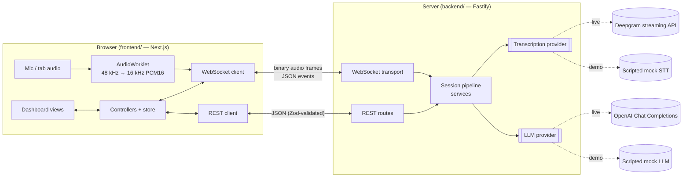
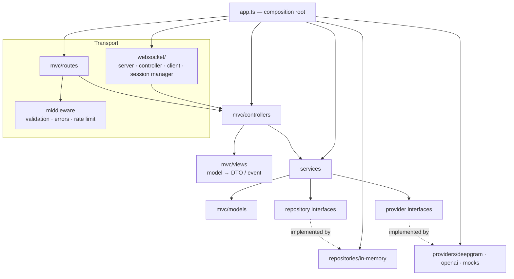
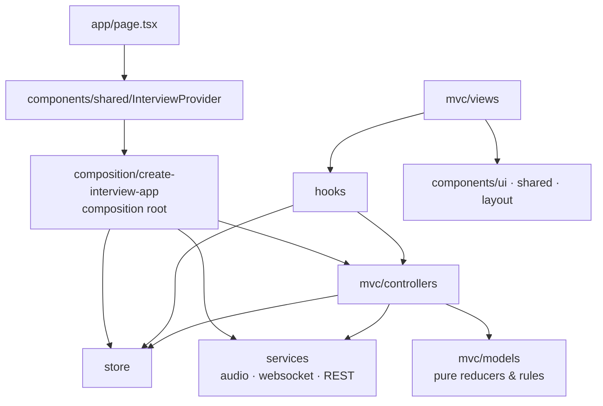

# Architecture

Cue is a real-time interview assistant. The browser streams audio to a Node.js
backend, which transcribes it, detects when the interviewer has finished asking
a question, and streams a short, resume-grounded answer back to the dashboard.

```
Audio capture → audio streaming → speech-to-text → transcript processing
→ question detection → LLM answer generation → streaming response → display
```

## 1. System context



API keys exist only in the server process. The browser only ever talks to our
own backend.

## 2. Projects

| Folder      | Purpose                                                                                                           |
| ----------- | ----------------------------------------------------------------------------------------------------------------- |
| `backend/`  | Standalone npm project: Fastify REST + WebSocket backend, organised as MVC + services/repositories/providers.     |
| `frontend/` | Standalone npm project: Next.js App Router dashboard, organised as MVC (models / views / controllers) + services. |

Each project carries the protocol contract in `src/shared`: Zod schemas,
inferred DTO types, the WebSocket event protocol, the binary audio frame codec
and constants. It is imported as `@shared` and depends on nothing but `zod`.

The backend's copy is the source of truth. `node scripts/sync-shared.mjs` copies
it to the frontend, and `--check` fails if the two copies differ. Client and
server therefore validate the same schemas without either project depending on
the other (see [TD-1](./technical-decisions.md)).

## 3. Backend layers



The arrows show the only allowed dependency directions. Each project's
`scripts/check-architecture.mjs` enforces them on every `npm run verify`; see
[mvc-structure.md](./mvc-structure.md).

**Controllers** are thin. They receive validated input, call one or two
services, and render the result through a view (presenter). They never touch
repositories, vendor SDKs or sockets.

**Services** hold the application workflows. `InterviewSessionService`
orchestrates one realtime session. It emits domain objects into a
`SessionEventSink` port. The WebSocket layer implements that port by delegating
to the controllers' presenters, so the whole pipeline can be tested without a
socket.

### Service responsibilities

| Service                    | Responsibility                                                                                                                                           |
| -------------------------- | -------------------------------------------------------------------------------------------------------------------------------------------------------- |
| `InterviewService`         | Create, read, update and delete interviews; context updates; session binding; TTL purge with cascade delete.                                             |
| `InterviewSessionService`  | Per-session orchestration: audio → STT → detection → answer → sink; state machine; suspend/resume; status ticks.                                         |
| `AudioStreamService`       | Frame ordering and duplicate rejection, audio stats, ingestion latency, forwarding PCM to STT.                                                           |
| `TranscriptionService`     | Owns provider streams: result normalisation, partial de-duplication, duplicate-final suppression, persistence, STT latency, reconnect with audio offset. |
| `QuestionDetectionService` | Per-session detectors: pause/endpoint/gap triggers, linguistic heuristics, minimum length, duplicate suppression.                                        |
| `AnswerGenerationService`  | Prompt building, streaming, one in-flight answer per session, cancellation and timeout via `AbortSignal`, latency metrics.                               |
| `LatencyMetricsService`    | Bounded sliding-window latency statistics (last/avg/p50/p95/min/max) per interview.                                                                      |

## 4. Frontend layers



- **Models** are pure functions with no React. Examples: `applyDelta`,
  `groupUtterances`, `deriveDisplayStatus`, `validateContext`, `rateLatency`.
- **Controllers** are framework-free classes. They handle UI actions and server
  events, coordinate services, and write to the store through the models.
- **Views** render data from hooks and call hook actions. They never import
  services, controllers or the store.
- The **store** is a ~40-line external store read through
  `useSyncExternalStore`, so no state library is needed.
- **Services** wrap browser APIs: Web Audio and AudioWorklet, WebSocket, and
  `fetch`.

## 5. Realtime pipeline walk-through

1. **Start.** The controller validates the context, then calls `POST /api/v1/interviews` with the mode and context.
   It opens the WebSocket and sends `session.start`. The server opens a provider
   stream and replies `session.ready`, followed by `session.status (listening)`.
   Only then does audio capture start.
2. **Capture.** `getUserMedia` (microphone) and/or `getDisplayMedia` (tab audio)
   feed one AudioContext, where multiple sources are summed. An AudioWorklet
   down-mixes and resamples to 16 kHz PCM16 off the main thread and posts 50 ms
   frames.
3. **Stream.** Each frame is wrapped in a 16-byte binary header (sequence number
   - capture time shifted to the server clock) and sent as a binary WebSocket
     message. If the socket buffer exceeds 256 KB, frames are dropped and counted,
     because queued audio would only add latency.
4. **Ingest.** The WS controller rate-limits the frame, decodes and validates it,
   then calls `AudioController.handleChunk`. That forwards to
   `AudioStreamService`, which rejects out-of-order frames and records ingestion
   latency before handing PCM to `TranscriptionService.write`.
5. **Transcribe.** The provider emits interim and final results.
   - Interim results with unchanged text are skipped, and empty finals are dropped.
   - Replayed finals (same text, overlapping audio range) are suppressed.
   - Finals are persisted.
   - Every result produces `transcript.partial` / `transcript.final` and a
     transcription latency sample.
6. **Detect.** The per-session `QuestionDetector` buffers the finals of the
   current utterance and evaluates them when one of these fires:
   - the provider's utterance-end signal;
   - the configurable silence timer (`QUESTION_SILENCE_THRESHOLD_MS`, postponed
     while interim speech continues);
   - an audio-time gap between finals;
   - a fast path when a `speech_final` segment ends with "?".

   The utterance is then cleaned of fillers and scored by the linguistic
   heuristics (section 6). It must also pass the minimum-length rule and
   duplicate suppression.

7. **Answer.** `question.detected` is sent. `AnswerGenerationService` aborts any
   in-flight answer and builds the prompt from the resume, job description,
   instructions, recent transcript and question. It then streams tokens as
   `answer.delta` events and finishes with an authoritative `answer.completed`.
8. **Display.** Controllers fold events into the store through the models, and
   views re-render only the slices that changed.

## 6. Question detection

Each sentence (and each comma-separated clause) is scored with weighted rules:

| Signal                                                              | Weight |
| ------------------------------------------------------------------- | -----: |
| Ends with `?`                                                       |   0.55 |
| Imperative prompt (“tell me about”, “walk me through”, “describe”…) |   0.50 |
| Curiosity phrase (“I’d like to hear…”, “I’m curious…”)              |   0.50 |
| Auxiliary inversion with you/we (“could you…”, “do you…”)           |   0.45 |
| Wh-word start (not declarative “what I did…”)                       |   0.35 |
| Other auxiliary inversion (“is there…”)                             |   0.35 |
| Wh-word followed by an auxiliary (“how would…”)                     |  +0.25 |
| Embedded prompt anywhere (“…walk me through…”)                      |  +0.20 |

The utterance confidence is the best sentence score, capped at 1. It is a
question when the confidence reaches `QUESTION_CONFIDENCE_THRESHOLD` (default
0.5) and it has at least `QUESTION_MIN_WORDS` meaningful words.

Before scoring:

- **Fillers** (um, uh, hmm…) are removed, along with the commas that framed them.
- **Pure acknowledgements** (“Great, thanks.”) and **small talk** (“Can you hear
  me?”) are rejected.

The question text drops leading acknowledgements and discourse markers but
keeps one sentence of lead-in context.

A new question is suppressed as a duplicate when its content-word Jaccard
similarity with a question asked in the last 2 minutes is at least 0.8.

## 7. Latency instrumentation

| Metric              | Measured as                                                                                                                  |
| ------------------- | ---------------------------------------------------------------------------------------------------------------------------- |
| `audioIngestion`    | Server receipt − client capture time. The client shifts capture time by an RTT-based clock offset estimated from heartbeats. |
| `transcription`     | Transcript arrival − the moment the audio it covers was sent to the provider (via an audio-time → wall-clock timeline).      |
| `questionDetection` | Detection time − arrival of the utterance's last final segment (includes the deliberate pause wait).                         |
| `llmFirstToken`     | First delta − LLM request start.                                                                                             |
| `answerTotal`       | Completion − LLM request start.                                                                                              |
| `endToEnd`          | First answer token − end of the interviewer's utterance (user-perceived latency).                                            |

Stats are kept in a bounded window of 200 samples per metric. They are pushed
every 2 s in `session.status`, available from `GET /api/v1/interviews/:id/metrics`,
and shown in the diagnostics panel, coloured against `LATENCY_BUDGETS_MS`.

## 8. Reliability and resource hygiene

- **Reconnect.** The client reconnects with exponential backoff and jitter. The
  server keeps a dropped session _suspended_ for `SESSION_RESUME_GRACE_MS`, with
  provider streams kept alive by KeepAlive. A `session.start` carrying
  `resumeSessionId` re-attaches to it. A clean close (code 1000) stops the
  session immediately.
- **Provider resilience.** An unexpected Deepgram close triggers up to 3
  reconnects with backoff. Audio is buffered in a bounded backlog, and timestamps
  continue from the audio already sent.
- **Backpressure.** The server coalesces outbound events when the socket is
  congested. Interim transcripts follow latest-wins, and consecutive deltas are
  concatenated. A client that still cannot keep up is disconnected with 1013.
  The client drops audio frames rather than buffering them.
- **Limits.**
  - 256 KB maximum WebSocket message.
  - Per-connection token bucket (burst 120, 60 msg/s), with the connection
    closed after sustained abuse.
  - 5 connections per IP.
  - HTTP rate limits: 120/min, and 30/min for interview creation.
  - Zod size limits on all context fields.
- **Cleanup.**
  - Every timer is cleared on stop, and timers that can outlive a session are `unref`'d.
  - Repositories are capacity-bounded, and idle interviews expire after 2 h with
    cascade delete.
  - `AbortSignal.any([cancel, timeout])` guarantees that LLM requests end.
  - Graceful shutdown stops sessions, closes provider streams, then closes sockets.

## 9. Security

- Secrets stay on the server and are validated at startup (`env.config.ts`).
- Every external input is validated with Zod, and so are provider responses
  from Deepgram.
- CORS uses an explicit origin allow-list, and WebSocket upgrades are rejected
  for foreign `Origin` headers, which prevents cross-site WebSocket hijacking.
- Helmet sets security headers on the API. The web app sets
  `Permissions-Policy`, `X-Frame-Options` and `nosniff`.
- Resume and job-description content is never logged:
  - pino redaction covers the context fields;
  - `InterviewContext.toJSON()` serialises only character counts;
  - REST responses echo only character counts.
- Prompts wrap context in tags declared as data, which mitigates prompt
  injection through pasted text.

## 10. Testing strategy

| Layer          | Tooling                     | What is covered                                                                                                                                 |
| -------------- | --------------------------- | ----------------------------------------------------------------------------------------------------------------------------------------------- |
| Shared         | Vitest                      | Audio frame codec, event and context schemas.                                                                                                   |
| Server unit    | Vitest + fake timers        | Models, heuristics, detector triggers, transcription (dedupe, latency, reconnect), answer streaming/cancel/timeout, metrics, validators.        |
| Adapters       | Vitest + local fake servers | Deepgram adapter against a local `ws` server, OpenAI adapter against a local SSE HTTP server, mock providers.                                   |
| Integration    | Vitest + real Fastify       | REST resources, CORS, rate limits; WebSocket lifecycle, audio → answer workflow, cancel, resume, grace expiry, origin/size/rate limits.         |
| Web unit       | Vitest + jsdom              | Models, WebSocket service (reconnect, heartbeat, clock offset, drops), REST client, controller flows.                                           |
| Web components | Testing Library             | Dashboard rendering, start/stop, transcript, streaming answer, cancel, diagnostics, error states.                                               |
| E2E            | Playwright (Chromium)       | Real backend + production web build. Chromium's fake microphone provides genuine audio: start → transcript → question → streamed answer → stop. |

None of the tests need credentials.
