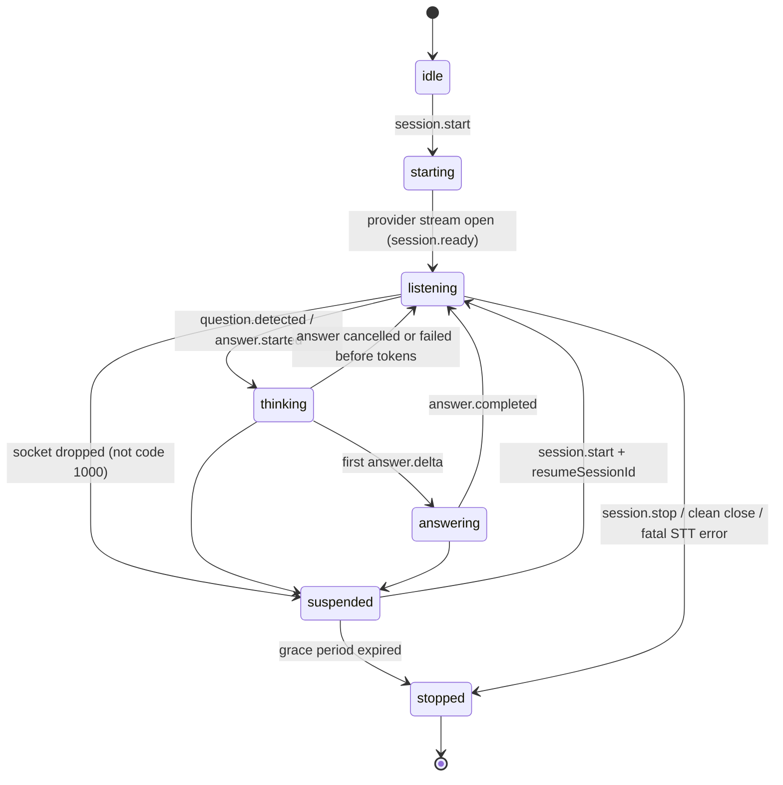
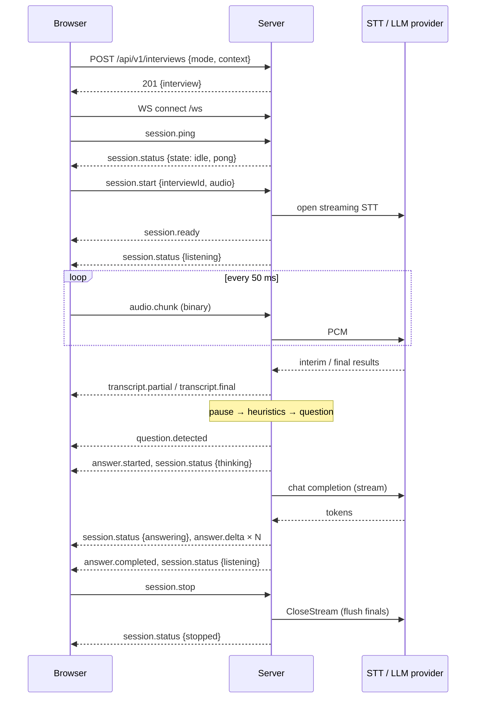

# WebSocket protocol (v1)

The schemas in `backend/src/shared/events` are the source of truth (mirrored to
`frontend/src/shared/events` by `scripts/sync-shared.mjs`). The client
and server both validate every message with them.

## Endpoint and limits

| Item                | Value                                                                                                                                                         |
| ------------------- | ------------------------------------------------------------------------------------------------------------------------------------------------------------- |
| URL                 | `ws(s)://<server>/ws`                                                                                                                                         |
| Origin              | Must be in `CORS_ORIGINS` (non-browser clients without `Origin` are allowed). Otherwise `403` before the upgrade.                                             |
| Connections per IP  | `WS_MAX_CONNECTIONS_PER_IP` (default 5). Otherwise `429` before the upgrade.                                                                                  |
| Max message size    | 256 KB (text or binary). Larger messages close the socket with `1009`.                                                                                        |
| Inbound rate        | Token bucket per connection: burst 120, refill 60 msg/s. Excess messages are dropped with `RATE_LIMITED`; after 500 violations the socket closes with `1008`. |
| Transport heartbeat | The server pings every 15 s and terminates connections that do not pong.                                                                                      |

## Envelopes

Client → server (JSON text frames):

```json
{ "type": "session.start", "payload": { … } }
```

Server → client (always JSON):

```json
{ "type": "answer.delta", "sessionId": "uuid | null", "ts": 1730900000000, "payload": { … } }
```

`ts` is server epoch time in milliseconds. `sessionId` is `null` only for
messages sent before a session exists (pongs, start errors).

## Binary `audio.chunk`

Audio travels as binary frames. The connection identifies the session, so a
frame carries no session id. The layout is little-endian:

| Offset | Size | Field                                                                       |
| -----: | ---: | --------------------------------------------------------------------------- |
|      0 |    1 | frame type: `0x01` (audio)                                                  |
|      1 |    1 | version: `1`                                                                |
|      2 |    2 | reserved: `0`                                                               |
|      4 |    4 | `uint32` sequence number (monotonic per capture)                            |
|      8 |    8 | `float64` capture time, epoch ms **in the server clock**                    |
|     16 |    n | PCM16LE mono samples at the negotiated sample rate (n even, 0 < n ≤ 32 000) |

The browser sends 50 ms frames: 800 samples, 1 600 payload bytes, 20 frames/s.
Frames whose sequence number is not greater than the last accepted one are
dropped, which covers duplicates and reordering. Invalid frames produce
`session.error INVALID_AUDIO_FRAME`.

Use `encodeAudioFrame` / `decodeAudioFrame` from `@shared` rather than
hand-rolling the layout.

## Client events

| Type            | Payload                                                                                       | Notes                                                                                                            |
| --------------- | --------------------------------------------------------------------------------------------- | ---------------------------------------------------------------------------------------------------------------- |
| `session.start` | `{ interviewId, audio: { encoding: 'linear16', sampleRate, channels: 1 }, resumeSessionId? }` | Starts a session for an interview created over REST. With `resumeSessionId`, re-attaches to a suspended session. |
| `audio.chunk`   | binary frame (above)                                                                          | Only after `session.ready`.                                                                                      |
| `session.stop`  | `{ sessionId, reason? }`                                                                      | Flushes the STT provider, cancels answers, replies with `session.status stopped`.                                |
| `session.ping`  | `{ clientSentAt }`                                                                            | Answered with `session.status` carrying `pong`. Used for RTT and clock offset.                                   |
| `answer.cancel` | `{ sessionId, answerId? }`                                                                    | Aborts the in-flight answer; it then completes with `finishReason: 'cancelled'`.                                 |

## Server events

| Type                 | Payload                                                                                                                                                                                                       |
| -------------------- | ------------------------------------------------------------------------------------------------------------------------------------------------------------------------------------------------------------- |
| `session.ready`      | `{ interviewId, resumed, mode, providers: { transcription, llm }, audio: { …format, frameDurationMs }, detection: { silenceThresholdMs }, protocolVersion }`. Providers carry `simulated: true` in Demo Mode. |
| `session.status`     | `{ state, reason?, metrics?, audio?, pong? }`. Sent on every state change, every 2 s with latency metrics and audio stats, and in reply to pings.                                                             |
| `transcript.partial` | `{ segment }` with `isFinal: false`. The `id` stays stable for the in-progress segment and is reused by its final.                                                                                            |
| `transcript.final`   | `{ segment: { id, text, isFinal: true, startMs, endMs, confidence, speechFinal, receivedAt } }`.                                                                                                              |
| `question.detected`  | `{ question: { id, text, confidence, reasons[], status, utteranceEndedAt, detectedAt } }`.                                                                                                                    |
| `answer.started`     | `{ answerId, questionId, provider, startedAt }`.                                                                                                                                                              |
| `answer.delta`       | `{ answerId, delta, index }`. `index` increases monotonically; coalesced deltas may skip indexes.                                                                                                             |
| `answer.completed`   | `{ answer: AnswerDTO, latency: { firstTokenMs, totalMs } }`. **Authoritative** full text and final status (`completed`, `cancelled` or `failed`).                                                             |
| `session.error`      | `{ code, message, recoverable }`.                                                                                                                                                                             |

### Session states



A newer question **supersedes** the in-flight answer: the server aborts it, so
it completes as `cancelled`, and then starts the new one.

## Typical sequence



## Error codes

| Code                           | When                                                                                                                   | Recoverable |
| ------------------------------ | ---------------------------------------------------------------------------------------------------------------------- | :---------: |
| `MALFORMED_MESSAGE`            | Text frame is not JSON                                                                                                 |      ✓      |
| `VALIDATION_ERROR`             | JSON does not match a client event schema                                                                              |      ✓      |
| `INVALID_AUDIO_FRAME`          | Binary frame header or payload is invalid                                                                              |      ✓      |
| `MESSAGE_TOO_LARGE`            | Message over 256 KB (the socket is also closed, `1009`)                                                                |      ✗      |
| `RATE_LIMITED`                 | Token bucket empty (throttled to one notice per second)                                                                |      ✓      |
| `SESSION_NOT_STARTED`          | Audio received before `session.ready`                                                                                  |      ✓      |
| `SESSION_ALREADY_ACTIVE`       | Second start on a connection, or the interview already has a live session                                              |      ✓      |
| `INTERVIEW_NOT_FOUND`          | Unknown `interviewId`                                                                                                  |      ✓      |
| `SESSION_NOT_FOUND`            | Unknown/expired `resumeSessionId`, or wrong `sessionId` in stop/cancel                                                 |      ✓      |
| `LIVE_MODE_UNAVAILABLE`        | Live Mode requested without Deepgram configured                                                                        |      ✓      |
| `TRANSCRIPTION_PROVIDER_ERROR` | STT failure; non-recoverable when reconnects are exhausted (the session then stops with reason `transcription_failed`) |     ✓/✗     |
| `LLM_PROVIDER_ERROR`           | Answer generation failed (the answer completes with status `failed`)                                                   |      ✓      |
| `INTERNAL_ERROR`               | Unexpected server error; the message is masked                                                                         |      ✓      |

## Close codes

| Code   | Meaning                                                                   |
| ------ | ------------------------------------------------------------------------- |
| `1000` | Normal close. The server stops the session immediately.                   |
| `1001` | Server shutting down.                                                     |
| `1008` | Policy violation (sustained rate-limit abuse).                            |
| `1009` | Message too big.                                                          |
| `1013` | Outbound backlog overflow: the client is too slow.                        |
| `4000` | The session was resumed on another connection, so this one is superseded. |

Any other close (for example `1006`) suspends the session for `SESSION_RESUME_GRACE_MS`.

## Backpressure and ordering

**Server → client.** While the socket's `bufferedAmount` exceeds 1 MB, events
are queued and coalesced:

- `transcript.partial` — only the latest is kept.
- Consecutive `answer.delta` for the same answer — concatenated.
- Everything else — kept in order.

When more than 2 000 events are queued, the server closes the socket with `1013`.

**Client → server.** Audio frames are **dropped**, not queued, when the
browser's socket buffer exceeds 256 KB. Late audio is worthless for live
transcription. Drops are counted in the diagnostics panel.

**Ordering.** WebSocket messages arrive in order. Clients should:

- ignore deltas whose `index` is not greater than the last applied index;
- treat `answer.completed` as authoritative.

## Clock synchronisation

The client pings every 5 s and computes:

```
rtt    = now − clientSentAt
offset = serverReceivedAt − (clientSentAt + rtt / 2)
```

Both values are exponentially smoothed. Audio capture timestamps are sent as
`captureTime + offset`, which makes `audioIngestion` latency meaningful across
machines. The estimate is accurate to roughly ±RTT/2 when the network path is
asymmetric.
